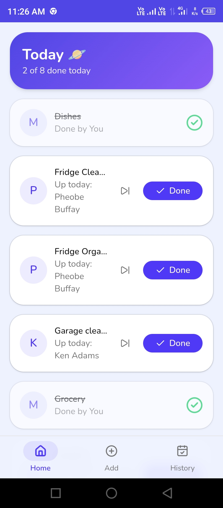
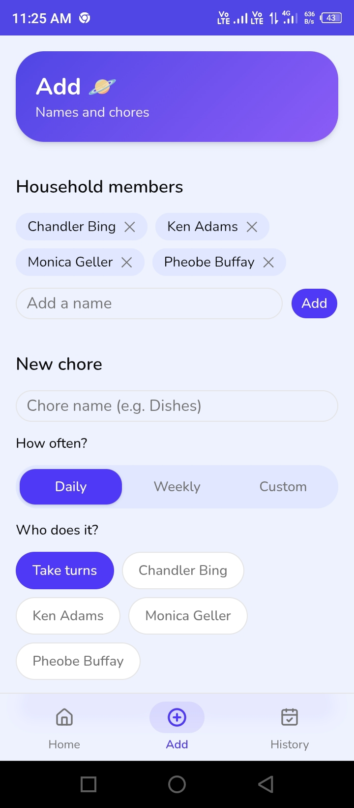
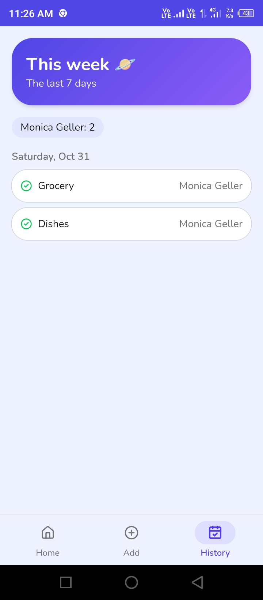

# Orbit 🪐
**Rotate. Share. Done.**

A mobile-first chore rotation app for households. It decides who does what today, so nobody has to nag anyone.

**Live demo:** https://orbit-five-bice.vercel.app/

<p>
  
  
  
</p>

## What it does
- **Today's rotation:** each due chore goes to the household member with the lightest load, so the work stays fair. Chores can also be pinned to one person.
- **One-tap Done:** credits whoever is logged in and taps it.
- **Skip for today:** skip a chore, with undo. It comes back tomorrow.
- **Edit and delete chores:** daily, weekly, or every N days.
- **Household invites:** share an 8-character join code. Others sign up, join, and pick their name.
- **Weekly history:** the last 7 days, with a count per person.
- **Installable PWA:** add it to your home screen. It has an animated splash screen.

## Tech stack
Next.js (App Router) · TypeScript · Tailwind CSS · shadcn/ui · Supabase (Postgres + Auth) · Vercel

## How the rotation works
`lib/rotation.ts` checks which chores are due today (from each chore's frequency and last completion). It gives each one to the member with the lightest load, counting what they've already done and what they've been given today. Pinned chores go straight to their person.

## Households and security
- Supabase Auth handles login.
- Row Level Security policies mean you can only read and write data for the household you belong to. A helper database function (`my_household_ids`) keeps the policies simple.
- Joining with a code, picking your name, and skipping or updating chores run as small database functions.

## Run it locally
```bash
git clone https://github.com/HoorUlAin-Pixel/orbit.git
cd orbit
npm install
```
Create a `.env.local` file:
```
NEXT_PUBLIC_SUPABASE_URL=your-project-url
NEXT_PUBLIC_SUPABASE_ANON_KEY=your-anon-key
```
You also need a Supabase project with these tables: `households`, `household_users`, `members`, `chores` and `completions`. Then:
```bash
npm run dev
```

## Scope decisions
Built to be finished, not perfect. v1 had 3 screens and one core feature. v2 added sharing (invites), chore management, and polish. Deliberately left for later: offline support, push notifications, and wrapping the PWA as an Android app (Bubblewrap).

