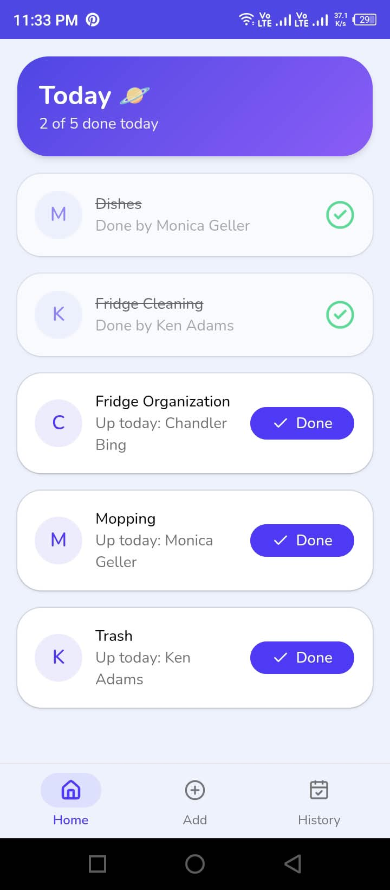
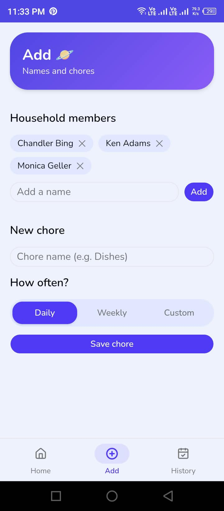
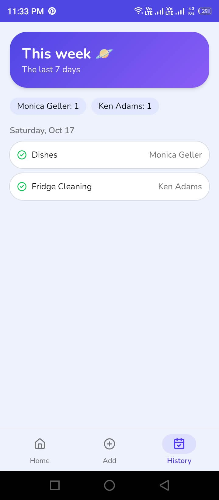

# Orbit 🪐
**Rotate. Share. Done.**

A mobile-first chore rotation app that decides who does what today, so nobody has to nag anyone.

**Live demo:** https://orbit-five-bice.vercel.app/

![Orbit screenshot]

<p>
  
  
  
</p>


## What it does
- **Today's rotation:** each due chore goes to the household member who has done the fewest, so the load stays fair.
- **One-tap "Done":** mark a chore complete from your phone.
- **Weekly history:** see what got done in the last 7 days, and by whom.
- **Installable:** works as a home-screen app (PWA).

## Tech stack
Next.js (App Router) · TypeScript · Tailwind CSS · shadcn/ui · Supabase (Postgres + Auth) · Vercel

## How the rotation works
`lib/rotation.ts` checks which chores are due today (based on each chore's frequency and its last completion). It then assigns each one to the member with the lightest load, counting what they've already done and what they've been given today.

## Security
Supabase Auth handles login. Row Level Security policies mean each user can only read and write their own household's data.

## Run it locally
```bash
git clone https://github.com/HoorUlAin-Pixel/orbit.git
cd orbit
npm install
```
Create a `.env.local` file:
```
NEXT_PUBLIC_SUPABASE_URL=your-project-url
NEXT_PUBLIC_SUPABASE_ANON_KEY=your-anon-key
```
Run the SQL schema in your Supabase SQL editor, then:
```bash
npm run dev
```

## Scope decisions
Built to be finished, not perfect: 3 screens, one core feature. Deliberately left for v2: household invites, pinning a chore to one person, offline support, notifications.

## About
[OPTIONAL: one line about why you built it, e.g. "Built in short nap-time sessions while returning to web development after a career break." Keep it or delete it, your call.]